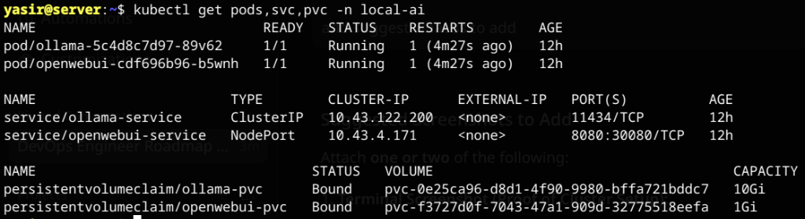
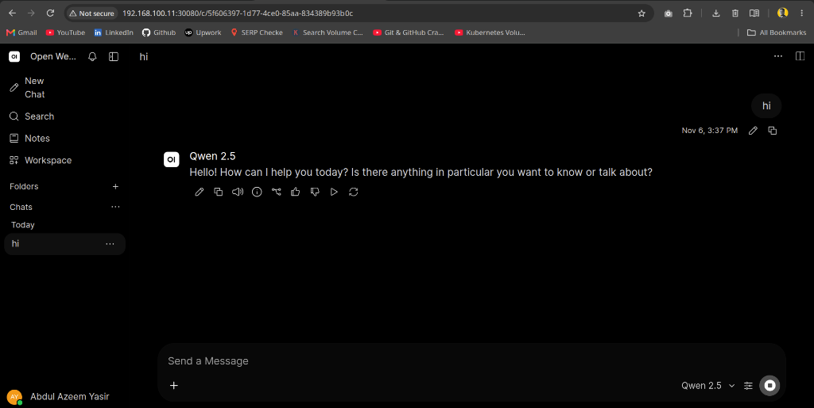

# Local AI on Kubernetes: Ollama + Open WebUI

Deploy a self-hosted, private AI infrastructure on Kubernetes using **Ollama** (LLM inference backend) and **Open WebUI** (ChatGPT-style web interface) with persistent storage and single-command deployment via **Kustomize**.

---

## Architecture Overview

```text
[ Browser / User ]
        │
        ▼ NodePort :30080 (or Ingress)
┌───────────────────────────────────────────────┐
│  Service: openwebui-service (NodePort)        │
└───────────────────────┬───────────────────────┘
                        │
                        ▼
┌───────────────────────────────────────────────┐
│  Deployment: openwebui                        │  <─── [openwebui-pvc (1Gi)]
│  Image: ghcr.io/open-webui/open-webui:main    │       (Users, chat history)
└───────────────────────┬───────────────────────┘
                        │ Internal DNS: http://ollama-service:11434
                        ▼
┌───────────────────────────────────────────────┐
│  Service: ollama-service (ClusterIP)          │
└───────────────────────┬───────────────────────┘
                        │
                        ▼
┌───────────────────────────────────────────────┐
│  Deployment: ollama                           │  <─── [ollama-pvc (10Gi)]
│  Image: ollama/ollama:latest                  │       (Model weights)
└───────────────────────────────────────────────┘
```

---

## Live Verification & Screenshots

### 1. Cluster Status (Pods, Services, PVCs)
All pods running healthy with services mapped and storage bound:



### 2. Open WebUI in Action
Running Qwen 2.5 locally through Open WebUI served from the cluster:



---

## Project Structure

```text
.
├── 01-dep-ollama.yaml         # Ollama deployment with CPU/RAM resource limits
├── 02-dep-openwebui.yaml      # Open WebUI deployment pointing to internal Ollama DNS
├── 03-svc-ollama.yaml         # Internal ClusterIP service (port 11434)
├── 04-svc-openwebui.yaml      # NodePort service exposing WebUI on port 30080
├── 05-pvc-ollama.yaml         # 10Gi PersistentVolumeClaim for model weights
├── 06-pvc-openwebui.yaml      # 1Gi PersistentVolumeClaim for user data and chats
├── 07-ingress-openwebui.yaml  # Optional Ingress definition for domain routing
├── kustomization.yaml         # Single-command deployment bundle for namespace local-ai
└── docs/
    └── images/                # Verification screenshots
```

---

## Quick Start

### 1. Create Namespace
```bash
kubectl create namespace local-ai
```

### 2. Deploy Everything via Kustomize
```bash
kubectl apply -k .
```

### 3. Check Pod Status
```bash
kubectl get pods,svc,pvc -n local-ai
```

---

## Pulling and Managing Models

Exec into the running Ollama pod to download models:

```bash
# Pull a model (e.g. Qwen 2.5 or Llama 3.2)
kubectl exec -it -n local-ai deployment/ollama -- ollama pull qwen2.5

# List installed models
kubectl exec -it -n local-ai deployment/ollama -- ollama list
```

---

## Accessing the Web UI

* **NodePort URL:** `http://<K8S_NODE_IP>:30080`
* **Local Port Forward:**
  ```bash
  kubectl port-forward -n local-ai svc/openwebui-service 8080:8080
  ```
  Visit [http://localhost:8080](http://localhost:8080) in your browser.
